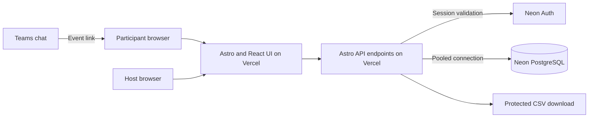

# GDG Bingo — Architecture Draft

Status: Draft for review. No application has been built or deployed.

Budget requirement: $0 recurring hosting/service cost using ongoing free plans, not trial credits. Readiness and provider eligibility remain unverified until implementation and rehearsal. This document does not guarantee perfect uptime or unlimited free capacity.

## Purpose

A phone-friendly bingo website shared through Teams chat. Participants exchange private single-use codes, claim squares, and receive automatically calculated results. Hosts control the round, view standings, reveal skill matches, and export results.

Design target: 300+ participants, to be validated against 350 concurrent simulated players. This is a target, not a measured capacity claim. Teams provides conversation and the event link; version one is a separate website without a Teams bot.

## Proposed stack

| Layer | Technology | Responsibility |
|---|---|---|
| Application | Astro + TypeScript | Page layouts, routing, server API endpoints |
| Interactive UI | React through `@astrojs/react` | Stateful card, claim form, board, and host controls |
| Styling | Tailwind CSS | Responsive and accessible interface |
| Database | Neon PostgreSQL | Authoritative events, players, codes, and claims |
| Data access | Drizzle ORM | Schema, migrations, queries, transactions |
| Identity | Neon Auth, pending integration verification | Secure player and host sessions |
| Hosting | Vercel only, using `@astrojs/vercel` | Static delivery and Node.js server endpoints; Hobby eligibility required for $0 |
| Repository | GitHub | Source history and deployment integration |
| Verification | Playwright and a load-testing tool | Browser flows, concurrency, event bursts |

Verify the selected Neon driver and Drizzle transaction API together before implementing claims. Use a pooled connection and nearby supported application/database regions.

## Astro rendering and UI approach

Astro is the chosen framework. Its advantage here is lightweight page delivery with JavaScript limited to interactive components; visual quality depends on layout, typography, spacing, feedback, and accessibility rather than the framework alone.

- Use `@astrojs/vercel` for on-demand routes and API endpoints on Vercel's Node.js runtime. Pin compatible supported Astro, React, adapter, and Node versions during implementation.
- Prerender instructions and public page shells. Keep personalised HTML and every mutation/auth/private-data endpoint on demand; never prerender player credentials or host data.
- Hydrate the active game UI immediately with a React island, such as `client:load`. Keep card, claim form, and progress in one state owner to avoid disconnected island state. Fetch private state only through authorised endpoints after session validation.
- Use Astro layouts/components for navigation, instructions, and visual structure; React components handle interactive game and host state. Board polling follows the existing 30-second policy.
- Implement API routes under `src/pages/api/` with server-side handlers and explicit on-demand configuration where required. Keep database, validation, scoring, and authorisation in server-only modules.
- Integrate Neon Auth through a supported browser SDK and server-side session validation verified against Astro Request/Response and cookie handling. A Next.js-specific helper is not an Astro integration. Verify redirects, CSRF/origin handling, secure cookies, and host permissions in Phase 1.
- Do not add Astro's separate session storage by default: use the validated auth session. If additional state is needed, persist it in Neon; in-memory or filesystem session stores are unsuitable across Vercel instances.
- Use Tailwind tokens for colours, typography, spacing, focus styles, and responsive grids. Provide readable square labels, touch-friendly controls, accessible dialogs, loading/error states, and reduced-motion support.

Astro does not remove backend work or guarantee 350-player capacity. Atomic transactions, rate limits, and load testing remain required. The website and API deploy only to Vercel; Neon remains the external database/auth provider.

## System boundaries

The browser receives public event data, its owner's card/codes, and limited board data. Database credentials and token-protection secrets stay server-side. Server code derives identity, permissions, scoring, and round timing; browser input is untrusted.

## Proposed game rules

These are recommendations, not approved changes to the original game:

- A 5 x 5 card has a free centre and 24 claimable squares.
- Each participant receives six outgoing codes per round.
- Each code confirms one square for one other participant, once globally.
- A claimant can accept only one confirmation from each other participant per round.
- Reject self-claims, repeated squares, spent codes, and claims outside the active round.
- Any full row, column, or diagonal qualifies as a line. Calculate lines and blackout on the server.
- Shuffle the same versioned square set per participant and persist the layout.
- Exhausting outgoing codes does not stop a player receiving confirmations.

At 300 players, two codes each provide only 600 total claims, averaging two per player. Even the easiest line requires four claims. Six codes provide 1,800 potential claims, enough in aggregate for everyone to complete a line, without guaranteeing participation or skill availability.

Under the proposed one-confirmation-per-person rule, blackout requires 24 distinct other participants. Under the original two-code rule without that restriction, it requires at least 12. Finalise prize tiers, round duration, and tie policy before opening the event.

## Identity and joining

1. Organisers distribute one private invitation per registered attendee.
2. The attendee signs in and redeems their invitation to join the event.
3. A transaction binds the invitation to their identity and creates their participation, stable layout, and code allowance.
4. Returning players resume that participation; retries cannot mint extra codes.

Display names are not identity. A public event link is not an invitation credential. Authentication alone does not prevent multiple accounts; controlled invitation distribution remains necessary. Host identities are explicitly authorised server-side.

Verify Neon Auth integration, provider/email setup, redirect handling, and recovery before selecting the exact sign-in flow. Avoid depending on an untested burst of verification emails at event start.

## Logical data model

| Record | Key fields and constraints |
|---|---|
| Events | ID, slug, title, status, start/end times, rules version, code allowance |
| Event hosts | Event ID and auth user ID; unique pair |
| Invitations | Event ID, unique token digest, redeemed participation, optional expiry |
| Participations | Event ID, auth user ID, display name, recruitment consent; unique event/user |
| Squares | Card version, square key, label, category, optional skill key |
| Card cells | Participation, position, square or free marker; unique position and square per card |
| Codes | Event, owner, unique token digest, encrypted redisplay value, ordinal, redeemed claim |
| Claims | Event, claimant, confirmer, square, code, server timestamp, request ID |
| Optional skill selections | Participation and skill key; unique pair |
| Host audit events | Event, actor, action, timestamp, safe metadata |

Claims need unique constraints for code, claimant/square, claimant/confirmer, and claimant/request ID within their event scope. Enforce event membership and square eligibility in the transaction, backed by foreign keys and check constraints where appropriate.

Generate codes with cryptographically secure randomness. Use a server-keyed digest for lookup and encryption for redisplay on returning devices. Store invitation digests. Never put secrets or codes in board responses, URLs, analytics, or logs.

## Atomic claim redemption

`POST /api/events/:eventId/claims` accepts a square key, code, and client-generated request ID.

1. Validate session, origin, input, membership, and shared rate limit.
2. Start a database transaction; coordinate round-state checks with host closure.
3. Check for a committed request ID: return the original success for an identical retry, rejecting changed payloads.
4. Lock the code row and validate event scope, active round, database time, owner, square, and existing claims.
5. Insert the claim and mark the code spent within the same transaction.
6. Commit and return authoritative card progress and results.

Expected conflicts roll back cleanly. A failed claim must not consume its code. Two simultaneous redemptions must yield exactly one committed claim. Retries after a lost success response must remain safe even after closure.

Use database time for deadlines. Specify and test how manual closure orders against in-flight claims, using compatible transaction locks. The browser countdown is informational.

## User and host surfaces

- Event page: instructions, round state, sign-in and join.
- Player page: private codes, copy controls, stable card, claim form, result feedback.
- Board: limited display names, claimed-square count, line count, outgoing codes remaining.
- Host dashboard: protected start/close controls, standings, reveal, export.
- Server endpoints: join, own state, claim, public board, host state changes, reveal, export.

Show confirmed progress only after server acceptance. Preserve unfinished input on failure and reuse the same request ID when retrying. Do not expose private codes or detailed skill histories on the public board.

## Capacity approach

Poll the board every 30 seconds with random staggering, only while the board is visible; pause hidden tabs and prevent overlapping requests. Stop polling after the final closed-round state is obtained, and stop unattended pre-event polling after inactivity. Return updated private state after each mutation instead of requiring another fetch.

At 350 clients, a 30-second interval averages about 11.7 board requests per second; launch bursts can be higher. Use short-lived shared caching for public aggregates, indexed queries, bounded waits, small paginated responses, and short transactions. Do not depend on per-process memory for a shared cache or rate limiter. Keep private responses out of public caches.

Use atomic, indexed PostgreSQL rate-limit buckets with bounded retention as the initial shared limiter; validate contention and database cost under load. Rate-limit authenticated players independently because meeting attendees may share an IP. No paid Redis service is required. Connected players are not equivalent to database connections.

Test simultaneous joins, competing claims, polling, retries, deadlines, closure, and cold starts. Free-tier allowances and two-device testing do not establish readiness for 300+ attendees.

## Reveal, privacy, and exports

Count distinct code owners per matched skill, not claim rows or claimants. Describe the results as peer-confirmed, self-reported matches. A valid code proves token possession, not a verified skill or conversation.

Optional skill selections provide a separate self-reported talent map. Keep these distinct from claim-derived counts. Collect explicit consent for recruitment follow-up; gameplay is not automatic consent. Agree public-name visibility and retention before launch. Protect exports with host authorisation and neutralise spreadsheet formula injection in CSV cells.

## Deployment and operations

Separate development/test data from production. Apply reviewed migrations as a controlled step. Configure database credentials, auth redirects, session secrets, code protection keys, and host identities through environment variables. Never expose server secrets through public environment-variable prefixes.

Confirm current provider plan eligibility, quotas, regions, and budget. Rehearse on the production configuration and check database readiness before the event. Record latency and errors without private tokens. Prepare scoped recovery and export procedures before destructive maintenance.

## Free deployment requirements

Checked against official provider documentation on 2026-10-18. These are published allowances, not throughput guarantees; verify them again before deployment and account for other projects sharing the account.

| Service | Relevant free allowance | Project requirement |
|---|---|---|
| Neon Free | 100 CU-hours/project/month; 1 GB database storage; 5 GB public transfer; up to 60,000 auth MAUs | Keep test and event usage within the remaining allowance; no paid upgrade |
| Vercel Hobby | 1 million function invocations, 4 active CPU-hours, 360 GB-hours provisioned memory, 100 GB fast data transfer | Personal, non-commercial eligibility must be established before selecting this host |

Vercel Hobby is restricted to personal, non-commercial use. A free-to-attend club event is not automatically proof of eligibility. Check the actual account, ownership, repository integration, and event use; do not deploy there if eligibility is unresolved. Hobby limit exhaustion can suspend features, so unused request quota alone is insufficient.

Vercel is the only application host; there is no alternate-host deployment path. If Hobby eligibility or free capacity cannot be established, the fixed Vercel-only/$0 requirements remain unmet and launch must wait for resolution. Do not change hosts or select a paid plan automatically.

Use the included `vercel.app` HTTPS subdomain; a purchased domain is unnecessary. No SMS, paid SMTP, paid analytics, media uploads, Redis subscription, AI API, or paid live-update service is required. Select an auth flow that works without paid email delivery, such as supported OAuth with event invitations; verify provider credentials and recovery in Phase 1. Distribute invitations through the organiser's existing channel without adding a messaging API.

### Event request budget

For 350 participants, six codes each, and a 20-minute open-board window:

- Board polling at 30 seconds: approximately 14,000 requests if everyone keeps the board open.
- Successful redemptions: at most 2,100, bounded by issued codes.
- Reserve approximately 8,900 additional requests for entry, state reads, failed attempts, retries, host actions, and exports.
- Planning envelope: 25,000 dynamic requests per event; this is an estimate, not a hard app-enforced cap. Measure actual auth and API call amplification separately.

Reserve at least 50,000 unused Vercel function invocations for the event and recovery, in addition to the measured CPU, memory, and transfer requirements. Include rehearsals and other projects sharing allowances. These are monthly-cycle resources: moving tests to another day does not restore them. Closed/idle tabs must not poll indefinitely. Unexpected traffic can exhaust free quotas despite rate limits; implement bounded exponential backoff and an organiser pause procedure.

At a constant 2 CU, one hour of Neon database activity consumes 2 CU-hours. This illustrates budget arithmetic only; it excludes other active computes, branches, rehearsals, and development time. Require at least 20 CU-hours remaining before the event and keep storage/transfer comfortably below limits. Record account dashboard readings before and after tests.

Use Vercel CDN response caching for a dedicated unauthenticated, public aggregate endpoint. Specify a short shared TTL and verify actual cache behaviour with the deployed Astro adapter. The public endpoint must not depend on cookies or return personal credentials. Send private state, claims, auth, and host responses with private/no-store policies. Do not add a paid cache product or use a cache as redemption authority.

### Zero-cost launch gates

- All required services are on ongoing Free/Hobby plans; no trial expiry, paid add-on, or automatic paid upgrade is part of the runbook.
- Hosting eligibility and the actual production auth/runtime combination are verified.
- A 350-player test passes on the selected free configuration, subject to provider load-testing rules. Obtain provider authorisation where required; Vercel explicitly prohibits unauthorised load testing. Local tests alone do not establish hosted capacity.
- Record invocation/request, CPU, memory, storage, transfer, and compute usage; retain enough headroom for the real event and recovery.
- Verify recovery after quota errors without duplicate claims. If a gate fails, tune, reduce scope, or postpone; do not claim event readiness or upgrade automatically.

Service charges are the $0 constraint; existing devices, internet access, and organiser time are assumed available. Free plans do not provide a promise of perfect availability, future pricing, or unlimited audience size.

## Decisions to approve

1. Six outgoing codes and one accepted confirmation per other participant.
2. Sign-in method, invitation distribution, and recovery.
3. Square set, shuffled layout, prizes, deadline, and tie policy.
4. Public names, recruitment consent, and retention period.
5. Event date, peak attendance, and Vercel Hobby eligibility within the fixed $0 service budget. Astro and Vercel-only application deployment are selected.

## References

- Neon pooling: https://neon.com/docs/connect/connection-pooling
- Neon Auth: https://neon.com/docs/auth/overview
- Neon pricing: https://neon.com/pricing
- Vercel plans: https://vercel.com/docs/plans
- Vercel Hobby allowances and eligibility: https://vercel.com/docs/plans/hobby
- Vercel load-testing and fair-use policy: https://vercel.com/docs/limits/fair-use-guidelines
- Astro Vercel adapter: https://docs.astro.build/en/guides/integrations-guide/vercel/
- Astro framework components: https://docs.astro.build/en/guides/framework-components/
- Astro API endpoints: https://docs.astro.build/en/guides/endpoints/

Recheck service capabilities and limits during implementation.
