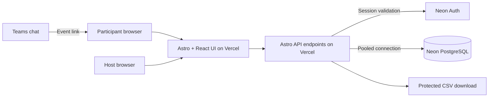
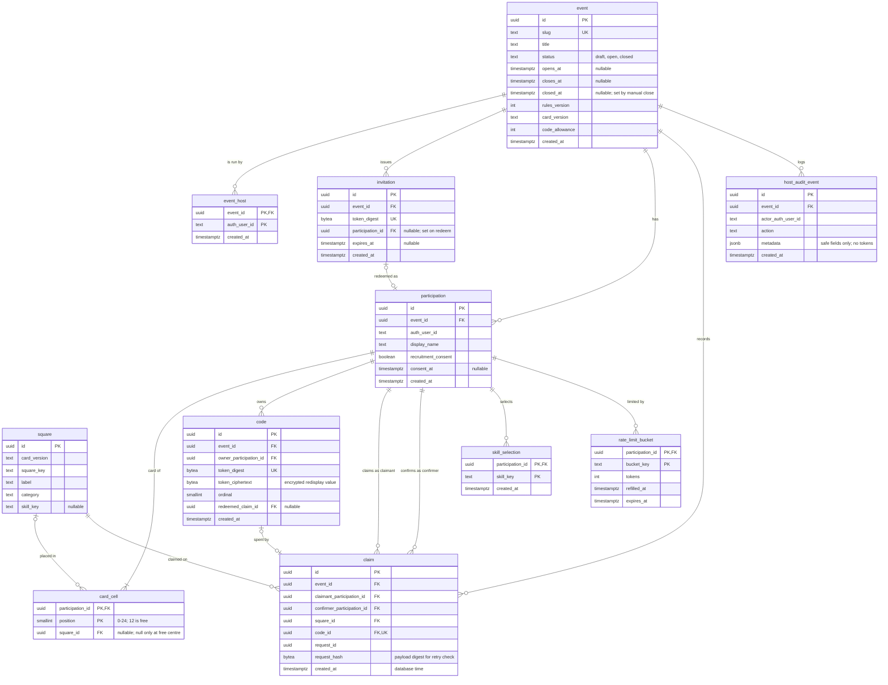

# System Design: GDG Bingo

**PRD:** [prd-gdgbingo.md](prd-gdgbingo.md)

Derived from the owner's [architecture.md](../architecture.md). Design-first: no
code exists yet.

---

## 1. Architecture

Astro + TypeScript site deployed only to Vercel (Hobby) through
`@astrojs/vercel`, running API endpoints on the Node.js runtime. React islands
(`@astrojs/react`, hydrated with `client:load`) own interactive state: one
island owns card, claim form, and progress together. Instructions and public
page shells are prerendered; personalised pages and every mutation, auth, or
private-data endpoint render on demand. Neon PostgreSQL is the single source of
truth, reached through a pooled connection from a region near the Vercel
functions. Neon Auth provides sessions (integration with Astro to be verified,
LOG Q3). The browser receives public event data, its own card and codes, and the
public board only.

## 2. Components

| Component | Responsibility | Serves | Location |
|-----------|---------------|--------|----------|
| Page shells and layouts | Prerendered instructions, navigation, structure | PRD-F13 | `src/pages/`, `src/layouts/` |
| Game island | Card, codes, claim form, progress; single state owner | PRD-F2, PRD-F3, PRD-F4, PRD-F5, PRD-F13 | `src/components/game/` |
| Board island | Visibility-aware jittered polling and standings view | PRD-F7 | `src/components/board/` |
| Host island | Start/close, standings, reveal, export controls | PRD-F8, PRD-F9, PRD-F11 | `src/components/host/` |
| Auth module | Session validation, origin/CSRF checks, host lookup | PRD-F1, PRD-F8 | `src/server/auth/` |
| DB module | Drizzle schema, pooled client, transactions | all | `src/server/db/` |
| Game module | Join, card shuffle, code issue, claim redemption, scoring, round timing | PRD-F1 to PRD-F6 | `src/server/game/` |
| Crypto module | CSPRNG tokens, keyed digests, redisplay encryption | PRD-F1, PRD-F3 | `src/server/crypto/` |
| Rate limiter | PostgreSQL token buckets keyed by participation | PRD-F12 | `src/server/ratelimit/` |
| Reveal and export | Distinct-confirmer counts, consent filter, CSV neutralisation | PRD-F9, PRD-F10, PRD-F11 | `src/server/reports/` |
| API routes | HTTP surface, input validation, cache headers | all | `src/pages/api/` |
| Seed and ops scripts | Synthetic data, invitation generation, rehearsal cleanup | PRD-F15 | `scripts/` |

## 3. Data model

**Schema file:** none yet (design-first)

The ERD below is the schema contract (hard rule 16): code may only use the
entities, fields, and relationships it defines. The planned schema location is
`src/server/db/schema.ts` with migrations in `drizzle/`.

### 3.1 Entity-relationship diagram

### 3.2 Entity register

| Entity | Serves | Constrained by | Data class | Retention | Notes |
|--------|--------|----------------|------------|-----------|-------|
| event | PRD-F6 | INV-4 | internal | TBD(owner) per LOG Q7 | One active round per event |
| event_host | PRD-F8 | INV-6 | internal | Event lifetime | Host authority is server-side only |
| invitation | PRD-F1 | INV-3, INV-5 | secret | Until event retention ends | Only the digest is stored |
| participation | PRD-F1, PRD-F10 | INV-5 | PII | TBD(owner) per LOG Q7 | Display name is not identity |
| square | PRD-F2, PRD-F9 | — | public | Indefinite | Versioned by `card_version` |
| card_cell | PRD-F2 | INV-5 | internal | Event retention | Persisted layout |
| code | PRD-F3, PRD-F4 | INV-1, INV-2, INV-3 | secret | Event retention | Digest for lookup, ciphertext for redisplay |
| claim | PRD-F4, PRD-F5, PRD-F9 | INV-1, INV-2, INV-4 | internal | Event retention | Server timestamp only |
| skill_selection | PRD-F10 | — | PII | TBD(owner) per LOG Q7 | Separate from claim-derived skills |
| host_audit_event | PRD-F14 | INV-3 | internal | Event retention | Never stores tokens |
| rate_limit_bucket | PRD-F12 | INV-7 | internal | Expires with bounded retention | Replaces paid Redis |

### 3.3 Constraints and indexes

| Constraint | On | Why | Enforces |
|------------|----|-----|----------|
| UNIQUE (event_id, auth_user_id) | participation | One participation per user per event | INV-5 |
| UNIQUE (participation_id) WHERE NOT NULL | invitation | One invitation per participation | INV-5 |
| UNIQUE (participation_id, square_id) | card_cell | No repeated square on a card | PRD-F2 |
| CHECK (position = 12) = (square_id IS NULL) | card_cell | Only the centre is free | PRD-F2 |
| UNIQUE (event_id, owner_participation_id, ordinal) | code | Fixed allowance, no extra codes | INV-5 |
| UNIQUE (code_id) | claim | One claim per code | INV-1 |
| UNIQUE (event_id, claimant_participation_id, square_id) | claim | A square is claimed once | PRD-F4 |
| UNIQUE (event_id, claimant_participation_id, confirmer_participation_id) | claim | One confirmation per other participant (pending LOG Q2) | PRD-F4 |
| UNIQUE (event_id, claimant_participation_id, request_id) | claim | Idempotent retries | INV-1 |
| CHECK (claimant_participation_id <> confirmer_participation_id) | claim | No self-claims | PRD-F4 |
| UNIQUE (event_id, auth_user_id) | event_host | No duplicate host rows | INV-6 |
| INDEX (event_id, claimant_participation_id) | claim | Board and progress aggregation | PRD-F7 |
| INDEX (expires_at) | rate_limit_bucket | Bounded retention sweep | PRD-F12 |

### 3.4 Migration policy

Drizzle Kit generates SQL migrations into `drizzle/`; every migration is
reviewed in a PR before it is applied. Production migrations are a manual,
controlled step, never part of the Vercel build. Development and test use a
separate Neon branch or database from production. Destructive migrations need an
export first.

## 4. API surface

All private endpoints validate the session server-side and check `Origin` on
mutations. Private responses send `Cache-Control: private, no-store`.

| Method | Path | Auth | Serves | Notes |
|--------|------|------|--------|-------|
| POST | `/api/events/:eventId/join` | Session | PRD-F1, PRD-F2, PRD-F3 | Body: invitation token. Idempotent |
| GET | `/api/events/:eventId/me` | Session + participation | PRD-F2, PRD-F3, PRD-F5 | Own card, codes, progress |
| POST | `/api/events/:eventId/claims` | Session + participation | PRD-F4, PRD-F5 | Body: square key, code, request ID. Rate limited |
| PATCH | `/api/events/:eventId/me/profile` | Session + participation | PRD-F10 | Consent and skill selections |
| GET | `/api/events/:eventId/board` | None (public) | PRD-F7 | Reads no cookies; short shared CDN TTL; paginated |
| POST | `/api/events/:eventId/host/open` | Session + host | PRD-F6, PRD-F8 | Audited |
| POST | `/api/events/:eventId/host/close` | Session + host | PRD-F6, PRD-F8 | Takes event row lock; audited |
| GET | `/api/events/:eventId/host/state` | Session + host | PRD-F8 | Standings, qualification, ties |
| GET | `/api/events/:eventId/host/reveal` | Session + host | PRD-F9 | Distinct-confirmer counts |
| GET | `/api/events/:eventId/host/export.csv` | Session + host | PRD-F11 | Neutralised cells; audited |

## 5. Cross-cutting concerns

| Concern | Approach | Serves |
|---------|----------|--------|
| Authentication | Neon Auth session validated on every on-demand request; production OAuth provider with organiser-owned credentials, never the shared development email sender or test-user-only OAuth (pending LOG Q3) | PRD-F1, PRD-F8 |
| Authorization | Participation looked up from session user + event; host role from `event_host`; never from request body | PRD-F3, PRD-F8, PRD-F11 |
| Validation | Schema-validated inputs (square key, code format, UUID request ID); server derives everything else | PRD-F4 |
| Error handling | Typed domain errors mapped to 4xx with stable codes; unexpected errors 5xx with no token data; client keeps input and reuses request ID | PRD-F4, PRD-F13 |
| Secrets | Env vars on Vercel (database URL, auth secrets, code digest key, encryption key); never `PUBLIC_`-prefixed | INV-3 |
| Rate limiting | Atomic PostgreSQL bucket update per participation and action, never per IP (attendees share networks); bounded retention | PRD-F12 |
| Concurrency | Shared event-state lock for joins and claims, exclusive lock only for host state transitions; fixed lock order (event, then code); bounded deadlock retries | PRD-F4, PRD-F6 |
| Caching | Public board cached at Vercel CDN with short TTL; everything else `private, no-store` | PRD-F7 |
| Polling | 30 s jittered, visibility-gated, non-overlapping, exponential backoff on errors, stops after closure | PRD-F7, INV-7 |

The public board endpoint is the only unauthenticated API surface. It is safe to
leave open because it returns only display names and aggregate counts, reads no
cookies, and is cached.

### 5.1 Invariant enforcement

| INV-# | Enforced by | Location | How |
|-------|-------------|----------|-----|
| INV-1 | Claim transaction + unique index | `src/server/game/claim.ts` | `SELECT ... FOR UPDATE` on code row; `UNIQUE (code_id)` on claim |
| INV-2 | Claim transaction | `src/server/game/claim.ts` | Claim insert and code update in one transaction; any rejection rolls back both |
| INV-3 | Response serializers, log redaction, crypto module | `src/server/http/`, `src/server/crypto/` | Board DTO has no code fields; logger redacts tokens; only digests stored |
| INV-4 | API routes and game module | `src/pages/api/`, `src/server/game/` | Identity from session; timing from `now()` in SQL; scores computed server-side |
| INV-5 | Join transaction + unique indexes | `src/server/game/join.ts` | `UNIQUE (event_id, auth_user_id)`; insert-or-return in one transaction |
| INV-6 | Auth module guards | `src/server/auth/` | `requireParticipation` / `requireHost` on every private route |
| INV-7 | Stack choice and polling policy | `docs/build-gdgbingo.md` §5 | No paid dependencies; backoff and stop rules bound usage |

## 6. Feature-to-design map

| PRD-F# | Designed | Components | RFC |
|--------|----------|------------|-----|
| PRD-F1 | yes | Auth module, Game module, Crypto module | N/A |
| PRD-F2 | yes | Game module, Game island | N/A |
| PRD-F3 | yes | Crypto module, Game island | N/A |
| PRD-F4 | yes | Game module, Rate limiter, API routes | [rfc-gdgbingo-claim-redemption.md](rfc-gdgbingo-claim-redemption.md) |
| PRD-F5 | yes | Game module | N/A |
| PRD-F6 | yes | Game module, Host island | [rfc-gdgbingo-claim-redemption.md](rfc-gdgbingo-claim-redemption.md) |
| PRD-F7 | yes | Board island, API routes | N/A |
| PRD-F8 | yes | Host island, Auth module | N/A |
| PRD-F9 | yes | Reveal and export | N/A |
| PRD-F10 | yes | Game island, API routes | N/A |
| PRD-F11 | yes | Reveal and export | N/A |
| PRD-F12 | yes | Rate limiter | N/A |
| PRD-F13 | yes | Page shells, all islands | N/A |

## 7. Rejected alternatives

| Considered | Rejected because |
|-----------|------------------|
| Next.js | Owner selected Astro; Neon Auth Next.js helpers do not apply to Astro |
| Redis (Upstash etc.) for rate limits | Paid or quota-limited extra service; PostgreSQL buckets suffice (INV-7) |
| WebSockets / SSE | Out of scope (IDEA §4); polling fits the free tier |
| Astro session storage | Validated auth session suffices; in-memory or filesystem stores break across Vercel instances |
| Alternate host (Cloudflare, Netlify, Render) | Owner fixed Vercel-only hosting |
| Email magic links | Burst of verification emails at event start; paid SMTP risk |
| In-process memory cache or limiter | Not shared across serverless instances |

## 8. Open questions

- `TBD(owner)` Confirm the Neon Auth sign-in method (OAuth provider) once the Astro integration spike succeeds (LOG Q3).
